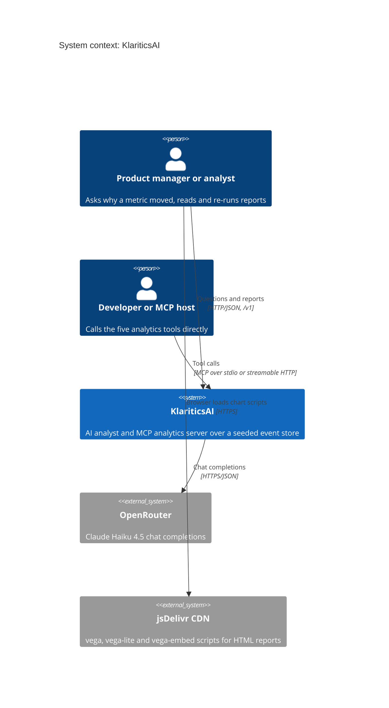
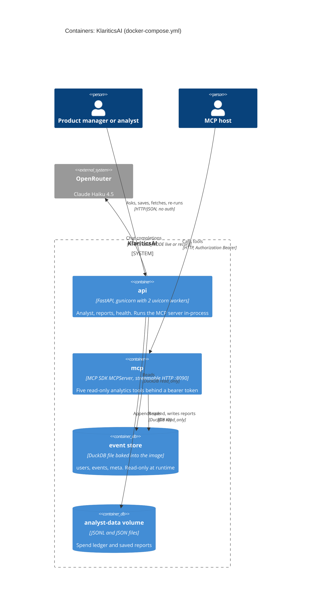
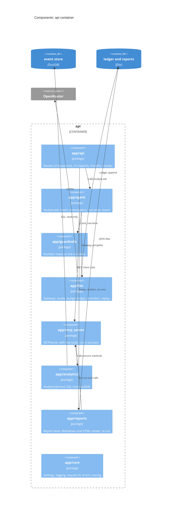
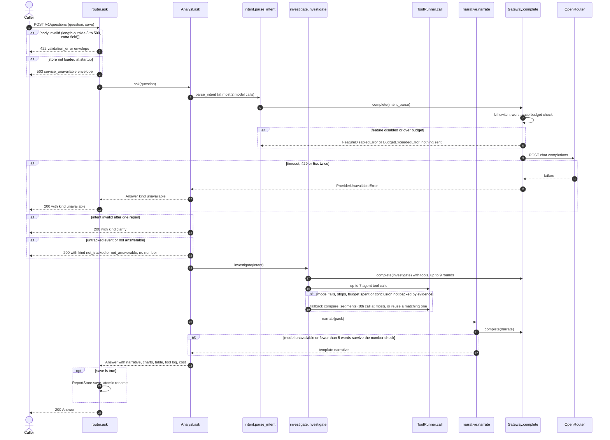
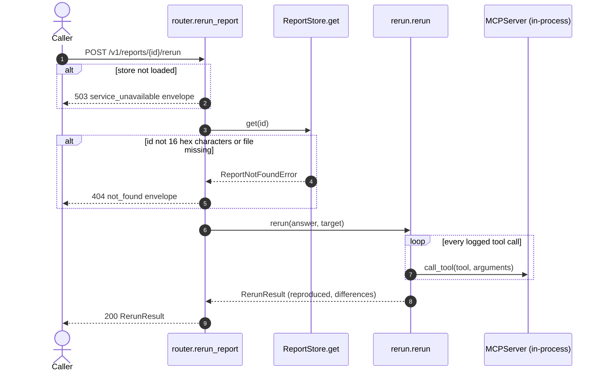

# Architecture: KlariticsAI

- Task: KAI-4
- Serves: REQ-001 to REQ-027, US-02-006, US-03-001, US-04-002, US-06-002, ADR-0002, ADR-0003, ADR-0004, ADR-0005
- Generated from the code on 2026-10-11 by architecture-diagram
- Sources: compose `docker-compose.yml`, k8s none, packages `app/`, image `Dockerfile`
- Drawn: [System architecture](diagrams/KlariticsAI_SystemArchitecture_v1.svg) ([PNG](diagrams/KlariticsAI_SystemArchitecture_v1.png)), [Architecture flow](diagrams/KlariticsAI_ArchitectureFlow_v1.svg) ([PNG](diagrams/KlariticsAI_ArchitectureFlow_v1.png)), rendered from [architecture.json](architecture.json)

There are no Kubernetes or Helm manifests, so the container view is drawn from
`docker-compose.yml` and the `Dockerfile`. That is the only deployment the
repository describes; the CI `deploy` job is a stub that exits 1
(`.github/workflows/ci.yml`).

## 1. Context

## 2. Containers

Each container has its own copy of the event store: the image seeds it at build
time (`Dockerfile` line `RUN .venv/bin/python -m app.seed`), so the two copies
are identical by seed, not shared.

## 3. Components: api

Packages under 30 lines are skipped: `app/domain/` (empty `__init__.py`).

## 4. Sequences

### Ask a why-question (POST /v1/questions, US-04-002, US-04-003)

Participants are the functions in `app/api/analyst/router.py`,
`app/agent/analyst.py`, `app/agent/intent.py`, `app/agent/investigate.py`,
`app/agent/narrative.py` and `app/llm/gateway.py`.

The ledger write happens after the provider replies (`Gateway.complete` in
`app/llm/gateway.py`). A crash between the reply and the append loses that
call's spend from the ledger; OpenRouter has already billed it.

### Re-run a saved report (POST /v1/reports/{id}/rerun, US-06-002)

## 5. Legend

| Style | Meaning |
| --- | --- |
| Solid edge | Call found in code or config (sources table) |
| Dotted edge (SVG) | Bulk write: the seeder builds the store once |
| Skipped | `app/domain/` (empty), tests, evals harness |
| Not drawn | `make mcp` stdio server: a local process started by an MCP host, same code as the `mcp` container |

## 6. Sources

| Element | File | Line |
| --- | --- | --- |
| api container | docker-compose.yml | 5 |
| mcp container | docker-compose.yml | 21 |
| gunicorn, 2 workers (WEB_CONCURRENCY) | Dockerfile | 19 |
| seeder at image build | Dockerfile | 13 |
| api -> event store, read-only | app/main.py | 48 |
| read-only connection | app/analytics/store.py | 93 |
| mcp -> event store | app/mcp_server/__main__.py | 28 |
| mcp bearer token | app/mcp_server/__main__.py | 37 |
| api -> OpenRouter | app/llm/providers.py | 33 |
| api -> ledger | app/llm/ledger.py | 73 |
| api -> reports | app/reports/store.py | 45 |
| api -> recordings | app/llm/providers.py | 167 |
| browser -> jsDelivr | app/reports/render.py | 13 |
| agent -> MCP in-process | app/agent/analyst.py | 170 |

## 7. Unconfirmed

- None. Every edge has a call site or a config line above. The OpenRouter key's
  own spend limit named in ADR-0004 is account configuration and is not drawn.
