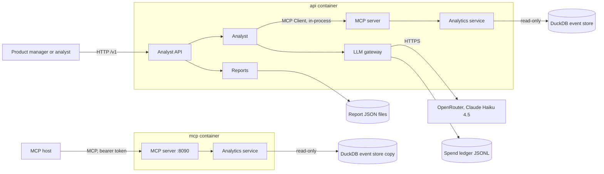

# High Level Design: Klaritics AI Analyst

- Task: KAI-4 (documents the system built under KAI-1, KAI-2 and KAI-3)
- Author: unattributed (no `.bearing/company.json`), 2026-10-11
- Status: Draft (section 1 not yet agreed by the owner; independent review not run, see section 16)
- PRD: [docs/product/PRD.md](../product/PRD.md); stories: [docs/product/stories.md](../product/stories.md)
- ADRs: [docs/architecture/decisions.md](../architecture/decisions.md)
- Tenets: [docs/architecture/tenets.md](../architecture/tenets.md)
- LLD: [docs/design/LLD.md](LLD.md); threat model: [docs/security/threat-model-klariticsai.md](../security/threat-model-klariticsai.md); events: [docs/analytics/EVENT_SHEET.md](../analytics/EVENT_SHEET.md)
- Serves: REQ-001 to REQ-035; US-01-001, US-01-002, US-02-001 to US-02-006, US-03-001 to US-03-003, US-04-001 to US-04-003, US-05-001, US-05-002, US-06-001, US-06-002, US-07-001; ADR-0001 to ADR-0006

This HLD is written after the code. Every claim about the system comes from
the code at `feature/KAI-3-M3Evals`; anything else is prefixed "assumption:".

## Summary

One Python 3.14 FastAPI service answers analytics questions in plain language:
a Claude Haiku 4.5 model, reached only through a capped OpenRouter gateway,
reads the question and drills into a read-only DuckDB event store through five
MCP tools, and code checks every conclusion and every number before the user
sees it. The same MCP server ships as a second container for other MCP hosts;
there is no database server, no queue, no user auth on the analyst API, and no
data source other than the seeded synthetic dataset.

Diagram: docs/architecture/diagrams/KlariticsAI_SystemArchitecture_v1.svg
(drawn from [architecture.json](../architecture/architecture.json); C4 views
in [klariticsai-c4.md](../architecture/klariticsai-c4.md))

## What gets built

| Component | Kind | Stack | Responsibility | Repository |
| --- | --- | --- | --- | --- |
| Analyst API | backend | Python 3.14, FastAPI, Pydantic v2, gunicorn with uvicorn workers, structlog | `/v1/questions`, `/v1/reports`, health; runs the analyst and an in-process MCP server | KlariticsAIAnalyst |
| MCP analytics server | backend | Python 3.14, MCP SDK `MCPServer`, uvicorn | Five read-only tools over stdio or bearer-protected streamable HTTP | KlariticsAIAnalyst |
| Seeder | data | Python 3.14, DuckDB | Builds the 20,000-user, 60-day store with three planted scenarios at image build | KlariticsAIAnalyst |
| Event store | data | DuckDB file | `users`, `events`, `meta`, read-only at runtime | KlariticsAIAnalyst |
| Eval harness | data | Python 3.14, replay recordings | 45 graded cases, gate in `evals/analyst/gate.json` | KlariticsAIAnalyst |

## 1. Goal and non-goals

Goal. A product manager or analyst asks why a metric moved, in their own
words, and gets the responsible segment, a short narrative, charts, a
contribution table and the full tool-call log, with every number traceable to
a tool result. Developers get the same five analytics capabilities as a
reusable MCP server. Model spend is capped at USD 8 in total and CI never
calls a model.

Non-goals:

- Writing anything back to Klaritics, and campaign creation (PRD section 3).
- Path analysis and top-properties analysis (stretch goals only).
- Any data source other than the seeded synthetic dataset; no live ingestion.
- User accounts, roles or per-tenant data on the analyst API (no auth model exists; see section 9).
- A web UI: reports are JSON, Markdown and a standalone HTML page (Q-002).
- More than one model or provider.

Agreement: not yet given by the owner (Vijay). The goal is restated from the
PRD, which the owner wrote.

## 2. Users and flows

Actors: product manager or analyst (PRD personas), developer or MCP host.

Flow A: explain a change (US-04-001 to US-04-003, US-05-001, US-06-001).

1. The caller sends `POST /v1/questions` with up to 500 characters (Analyst API).
2. The model parses an intent through a forced `submit_intent` tool call; code
   resolves events and filter values against the catalogue and periods against
   the last day of data (2026-09-30). One repair round, then `clarify`.
3. An untracked event or a question the data cannot answer ends here with no number (US-05-002).
4. The model investigates with up to 7 MCP tool calls and calls `finish`.
   Code accepts its cause only when a matching `compare_segments` result marks
   it `likely_cause`; otherwise the deterministic plan makes at most one more
   call (8 in total, REQ-011, REQ-012).
5. The model writes the narrative from an evidence pack; code removes every
   sentence with an unsupported number and falls back to a template when
   nothing usable survives (REQ-013, REQ-014).
6. The answer returns with charts (Vega-Lite specs), the contribution table,
   the tool log and the model cost; with `save: true` it is stored as a report.

Flow B: measure (US-04-001, US-06-001). Steps 1 to 3 as above, then one
planned tool call (no model in the loop), then the narrative as in step 5.

Flow C: keep and reproduce (US-06-002). The caller fetches a saved report as
JSON, Markdown or HTML, and `POST /v1/reports/{id}/rerun` repeats every logged
tool call and lists any result that changed.

Late arrivals and repeats: a question is answered synchronously; there is no
queued work. A repeated `POST /v1/questions` runs the whole analysis again and,
with `save: true`, stores a second report with a new id (no request id).

## 3. Architecture

**Analyst API** (owner: Vijay). FastAPI app built by `create_app`; the
lifespan opens the store read-only and builds one `Analyst` per process. It
talks to the analyst in-process, to the report store on the local filesystem,
and nothing else. Two gunicorn workers by default (`WEB_CONCURRENCY=2` in the
`Dockerfile`), each with its own store connection, analyst and ledger object.

**Analyst** (`app/agent`). Orchestrates intent, investigation, narrative and
charts. It reaches data only as an MCP client (ADR-0003), against the server
object in-process or a URL; it reaches the model only through the gateway
(ADR-0004). The loop and its bound are plain code (ADR-0005).

**LLM gateway** (`app/llm`). Kill switch, route, worst-case budget check,
provider call with one retry, pricing, ledger append. Modes: live, record,
replay (`LLM_MODE`).

**MCP analytics server** (`app/mcp_server`). Five read-only, idempotent tools
over one `AnalyticsService`. stdio for local hosts, streamable HTTP with a
bearer token for services (ADR-0003). In the API it runs in-process; in
compose it is also the separate `mcp` container.

**Analytics service and event store** (`app/analytics`). Validates every
argument against the catalogue and the dataset range before any SQL; values
are bound parameters, column names come from a fixed list. DuckDB, opened
`read_only=True` (ADR-0002).

**Seeder** (`app/seed`). Deterministic (seed 42); runs at image build and by
`make seed`; writes `ground_truth.json` beside the store for evals.

**Reports** (`app/reports`). One JSON file per saved answer, Markdown and HTML
rendering, and re-run.

**Risks this leaves open**

- One process hosts the question route and the report routes; a slow question
  holds a worker's event loop only while it awaits, but DuckDB queries are
  serialised per process by one lock, so one long investigation delays every
  other question in that worker.
- The API and the `mcp` container each bake their own store copy; they agree
  only because the seed is fixed. A seed change shipped to one image and not
  the other gives different numbers for the same tool call.
- Reports and the ledger live on a local volume; two API replicas on two hosts
  would each have their own (no shared store, assumption: one host today).

## 4. Data

| Entity | Owner | Store | Retention | PII |
| --- | --- | --- | --- | --- |
| `users` (20,000 rows) | Seeder | DuckDB `data/klaritics.duckdb` (ADR-0002) | Rebuilt per image | None: synthetic ids `u00001` |
| `events` (872,645 rows in the local seed-42 store) | Seeder | same file | Rebuilt per image | None |
| `meta` (start, end, seed) | Seeder | same file | Rebuilt per image | None |
| Spend ledger, one line per model call | LLM gateway | JSONL at `LLM_LEDGER_PATH`, compose volume `analyst-data` | Forever: never truncated | None: tokens, cost, timing only |
| Saved report (`Answer`) | Reports | JSON at `REPORTS_DIR/<16 hex>.json`, same volume | Forever: no delete route | The question text, which a user may fill with anything |
| Model recordings | LLM gateway | `LLM_RECORDINGS_DIR/<feature>/<hash>.json` | Committed to git when recorded | Prompts include the question |

No migrations: the schema is created by the seeder (`app/analytics/store.py`)
and the file is rebuilt from scratch. The full model and its indexes are in
the LLD, section 5.

Growth: the event store is fixed. The ledger grows by one line per model
call, at most 12 per question (section 8). Reports grow by one file per saved
answer, and `GET /v1/reports` reads and parses every file on each call.

**Risks this leaves open**

- `GET /v1/reports` is a full scan of the report directory on every request,
  so its latency grows linearly with saved reports and has no cap.
- ADR-0002 says reports are stored in a separate DuckDB file; the code stores
  JSON files. Recorded as conflict 1 in `docs/architecture/decisions.md`.
- The ledger is read in full at start-up; it is small (one line per call) but
  never rotated.

## 5. Interfaces

No `api/openapi.yaml` is committed; FastAPI serves `/openapi.json` outside
production (`app/main.py`), and the shapes are the Pydantic models named below.

| Interface | New or changed | Contract |
| --- | --- | --- |
| `POST /v1/questions` | new | `QuestionIn` and `Answer`, `app/api/analyst/router.py`, `app/agent/analyst.py` |
| `GET /v1/reports` | new | `ReportSummary`, `app/reports/store.py` |
| `GET /v1/reports/{id}` and `/markdown`, `/html` | new | `Answer`, `app/reports/render.py` |
| `POST /v1/reports/{id}/rerun` | new | `RerunResult`, `app/reports/rerun.py` |
| `GET /healthz`, `GET /readyz` | new | `app/api/health/schemas.py` |
| Error envelope for every non-2xx | new | `ErrorEnvelope`, `app/core/errors.py` |
| MCP tools `list_events`, `count_events`, `funnel`, `retention`, `compare_segments` | new | input and output models in `app/analytics/models.py`; tool errors are JSON with `code`, `message`, `retryable`, `details` |
| OpenRouter chat completions (outbound) | new | `wire_body` in `app/llm/providers.py` |
| Seeded product events | new | [docs/analytics/EVENT_SHEET.md](../analytics/EVENT_SHEET.md) |

Repeated requests: `POST /v1/questions` takes no request id; a retried call
spends model budget again and, with `save`, creates a second report. Reads and
re-runs are idempotent. The MCP tools are read-only and idempotent.

## 6. External integrations

**OpenRouter** (Claude Haiku 4.5, `anthropic/claude-haiku-4.5`). Used for
intent parsing, investigation and narration. Timeouts are 30 s per call
(`app/llm/routing.py`); a timeout, 429 or 5xx is retried once after 0.5 to 1 s,
a 4xx is never retried. What the user sees:

- Down or rate limited during intent: a `200` answer of kind `unavailable`,
  no analysis run.
- Down during investigation: the deterministic plan answers
  (`concluded_by: fallback`).
- Down during narration: the template narrative answers.
- Slow: each call may take up to about 61 s (two 30 s attempts and a pause);
  there is no deadline for the whole question (section 8).

Credential: `OPENROUTER_API_KEY`, read into a `SecretStr`, sent only in the
`Authorization` header, never logged. It lives in `.env` locally and in the
compose environment; assumption: rotated by the owner in the OpenRouter
dashboard, which ADR-0004 says also carries a USD 8 key limit. A leaked key
can spend up to that account limit outside this service.

Provider facts not verified from OpenRouter's documentation in this session:
its rate limits, data retention and idempotency support. There is no
idempotency key on the request; a retried call after a lost reply is billed
twice. Open question Q-H03.

**jsDelivr CDN**. The HTML report page loads `vega@5.30.0`,
`vega-lite@5.21.0` and `vega-embed@6.26.0` from `cdn.jsdelivr.net`. Down: the
report text and table render, the charts do not. No subresource integrity
attributes are set.

### Deliberately not integrated

- Anthropic's API directly: the brief requires OpenRouter (ADR-0004).
- A database server (PostgreSQL): the data is static and read-only (ADR-0002).
- A product analytics SDK: the service emits no product events; the events it
  analyses are synthetic and seeded.
- An identity provider: no user accounts in scope; ADR needed before any non-local exposure.
- A model judge in evals: graders are deterministic (`evals/analyst/graders.py`).

**Risks this leaves open**

- No overall deadline per question: a slow provider can hold one request for
  minutes while callers time out, and spend continues for calls already in flight.
- No idempotency key on model calls, so a retry after a lost reply is billed twice.
- Report pages trust a third-party CDN without integrity hashes.

## 7. Failure modes

| Component | What fails | How it is noticed | What the user sees | How it recovers |
| --- | --- | --- | --- | --- |
| Event store | File missing or seeder unfinished at start | `store unavailable` warning log; `/readyz` 503 | `503 service_unavailable` on questions and re-runs | Re-seed and restart the process |
| Event store | Query error at runtime | Unhandled error log with request id | `500 internal` envelope | UNDEFINED (no retry; next request tries again) |
| LLM gateway | Provider down, slow or 429 | `llm unavailable` warning log | `unavailable` answer, fallback cause or template narrative (section 6) | One retry, then the next question tries again |
| LLM gateway | Spend limit reached | `BudgetExceededError` caught as an LLM error; no dedicated log or alert | `unavailable` answer for every question | Manual: raise `LLM_BUDGET_USD` or reset the ledger, both owner decisions |
| LLM gateway | Replay recording missing (`LLM_MODE=replay`) | `replay_missing` error with the hash | `unavailable` answer, or 45 errors in `make eval` | Run `make eval-record` with a key |
| LLM gateway | Crash between provider reply and ledger append | UNDEFINED | Nothing | Spend for that call is missing from the ledger; OpenRouter still billed it |
| Analyst | Model concludes a cause the evidence does not back | `fallback_reason` in the answer and the `answered` log | The deterministic cause, labelled `concluded_by: fallback` | Automatic |
| Analyst | Tool returns a typed error | Error kept in the tool log | Answer built from the remaining evidence | Automatic |
| Guardrails | Narrative number not in evidence | `removed_sentences` in the answer | Sentence removed; template if fewer than 5 words remain | Automatic |
| Reports | Malformed or unknown id | none needed | `404 not_found` | n/a |
| Reports | Disk full or volume missing on save | Unhandled error log | `500 internal`; the analysis spend is already incurred | UNDEFINED |
| MCP server (HTTP) | `MCP_HTTP_TOKEN` unset | Error log, exit code 2; compose refuses to start | Container does not start | Set the token |
| MCP server (HTTP) | Wrong or missing token | none | `401` with `unauthorized` | Caller fixes the token |

Check then act: the budget check reads spend before the call and the spend is
added after the reply, under separate lock holds. Concurrent calls in one
worker can each pass the check; the overshoot is at most the number of calls
in flight times one call's worst case. Across the two workers the in-memory
totals never see each other (section 8).

## 8. Scaling and limits

Expected load: assumption: a handful of analysts, well under one question a
second; no traffic data exists.

Per question, from the code:

- Tool calls: at most 8 (`MAX_TOOL_CALLS`, `app/agent/tools.py`); the cached
  `list_events` catalogue call is outside that count and runs once per process.
- Model calls: at most 2 (intent) + 9 (investigation rounds: a budget of 7
  plus 2) + 1 (narration) = 12.
- Output tokens per call: 500, 400 and 400 by route, never above 600.
- Measured DuckDB time on this 4-CPU container: `compare_segments` 140 to
  390 ms, `list_events` about 30 ms. Eight calls cost at most about 3 s of
  query time, serialised per process.

Spend: the worst case for one intent call with a 500-character question is
USD 0.0052 (computed with `worst_case_cost`); narration with a 3,000-character
pack is USD 0.0032. Investigation rounds grow with tool results; assumption:
at most USD 0.02 each. Worst case per question: 2 x 0.0052 + 9 x 0.02 + 0.0032
= about USD 0.19. The eval estimate (`docs/genai/evals.md`: about 180 calls
under USD 1) gives about USD 0.0056 per call and about USD 0.022 per question
at 4 calls.

Where it stops working: the USD 8 budget is cumulative and never resets. At
the eval estimate it covers about 360 questions in total; at the worst case,
about 42. After that every question returns `unavailable`. This is the first
limit the design hits, long before any CPU or storage limit.

Per-process limit: each of the 2 gunicorn workers loads the ledger total at
start and then counts only its own calls. With start-up spend S, the two
workers together can spend up to 2 x (8 - S) more, so the combined cap is up
to USD 16 minus S, not USD 8. The CLI (`make ask`) is a third process with its
own ledger path by default. Meeting REQ-026 as written needs one worker, or a
ledger re-read under a file lock before every check; this is an owner
decision (conflict 3 in `docs/architecture/decisions.md`). ADR-0004's key
limit at OpenRouter is the only cross-process guard, and it is assumption:
not visible in the repository.

Latency: worst case per question is 12 calls x about 61 s = about 12 minutes
with no overall deadline; gunicorn's `--timeout 60` does not stop an async
worker that is awaiting I/O.

**Risks this leaves open**

- The real spend cap is per process (up to USD 16 with 2 workers) until conflict 3 is settled.
- No per-caller rate limit: one caller can spend the whole budget.
- No per-question deadline: a slow provider ties up a worker for minutes.

## 9. Security and privacy

Auth model: the analyst API has none. Any caller that can reach port 8080 can
ask questions (and spend budget), list, read and re-run every saved report.
ADR needed: authentication and per-caller limits for the analyst API, before
it is reachable by anyone but the owner. The MCP HTTP transport requires a
single shared bearer token compared in constant time
(`app/mcp_server/auth.py`); there are no per-client identities or scopes, and
the tools are read-only.

Authorisation per resource: none; every report is visible to every caller.
Report ids are 64 random bits, which hides them from guessing but
`GET /v1/reports` lists them all.

PII: none in the dataset (synthetic ids and attributes). Questions are free
text and are stored in reports, sent to OpenRouter, and saved in recordings.

Secrets: `OPENROUTER_API_KEY`, `MCP_HTTP_TOKEN`; both `SecretStr`, both from
the environment, neither logged. Model output is untrusted: intent and
conclusions are validated in code, numbers are checked, and every value in
the HTML report is escaped. Prompt injection, cost exhaustion and the other
threats are in [the threat model](../security/threat-model-klariticsai.md).

**Risks this leaves open**

- An open API on a public port lets anyone spend the model budget and read every report.
- Narrative words are not checked, only numbers: an injected question can steer the prose (threat model T-02).
- One shared MCP token: revoking one client revokes all.

## 10. Observability

- Logs: structlog JSON with the request id bound per request
  (`app/core/middleware.py`), one `request` line per HTTP request, one
  `llm call` line per model call (feature, tokens, cost, latency, replayed,
  total spent; never prompt or answer text), one `answered` line per
  question (kind, `concluded_by`, tool calls, cost), `tool ok` or
  `tool refused` per MCP call.
- Traces: OpenTelemetry over OTLP/HTTP when `OTEL_EXPORTER_OTLP_ENDPOINT` is
  set; off otherwise. Only the FastAPI layer is instrumented.
- Metrics: none exported. Health: `/healthz`, `/readyz` (store query).
- Alerts: none defined, so no runbooks exist under `docs/runbooks/`. Proposed
  first alerts: `LlmBudgetNearlySpent` (ledger above USD 6) and
  `AnalystUnavailableRate` (share of `unavailable` answers); each needs a
  runbook before it is enabled.

**Risks this leaves open**

- Budget exhaustion is silent until users see `unavailable` answers.
- No metrics endpoint, so rate, errors and duration exist only in logs.

## 11. Analytics

| Business question | Source | Path |
| --- | --- | --- |
| Why did a product metric move, and which segment drove it? | Seeded `events` table, eight events and five dimensions | MCP tools, then the analyst answer and report |
| Does the analyst find the planted causes? | `ground_truth.json` and `evals/analyst/cases.jsonl` | `make eval`, gated by `evals/analyst/gate.json` |
| What does the analyst cost? | Spend ledger and the `answered` and `llm call` logs | Read the JSONL; no dashboard |

Product events are synthetic and live only in the DuckDB store; the event
sheet is [docs/analytics/EVENT_SHEET.md](../analytics/EVENT_SHEET.md). The
analytics store is DuckDB (ADR-0002). The service emits no product events of
its own, and the spend ledger is an audit of model calls, kept apart from the
product events.

**Risks this leaves open**

- Recorded eval answers do not exist yet, so the analyst's real accuracy is unmeasured (`make eval` currently reports 45 errors).
- The seeded events carry no order id, amount or currency, so revenue questions cannot be answered.

## 12. Rollout and rollback

- Phase 0 (done, per the owner; the merge commit is not in this clone): KAI-1 to KAI-3 merged to `main` in PR #1 on 2026-10-11 as one squashed commit.
- Phase 1: record eval answers (`make eval-record`, needs an OpenRouter
  session), commit `evals/recordings/`, then add a CI `eval` job running
  `make eval`. Back out: remove the job; recordings are inert files.
- Phase 2: deploy the image. The CI `deploy` job is a stub that exits 1, so
  there is no deployment path in the repository yet.

Controls: `LLM_KILL_INTENT_PARSE`, `LLM_KILL_INVESTIGATE`, `LLM_KILL_NARRATE`
are operator-owned environment switches; no user setting exists to confuse
them with. Killing `investigate` makes every why-question use the
deterministic plan; killing `intent_parse` makes every question `unavailable`.

Work in flight: questions are synchronous, so a restart drops in-flight
questions (the caller gets a connection error) and keeps the ledger and
saved reports on the volume. Rolling back the image keeps the volume; a
report saved by a newer `Answer` model may fail to parse in an older one
(UNDEFINED: no schema version on reports).

**Risks this leaves open**

- No deploy path exists; production readiness (REQ-034) stops at the image.
- Reports carry no schema version, so a rollback can make saved reports unreadable.

## 13. Outside the standard stack

- DuckDB as the analytics store (catalogue default: Postgres), ADR-0002: Architect or Engineering Manager sign-off pending.
- OpenRouter as the LLM provider (catalogue default: Anthropic through `llm-gateway`; OpenRouter is listed for prototypes), ADR-0004: sign-off pending.
- MCP SDK `MCPServer` as the tool boundary, ADR-0003: no catalogue key; sign-off pending.
- Publishing from cloud sessions through the GitHub connector, ADR-0006: process, not runtime; sign-off pending.

## 14. Repository plan

From [docs/architecture/repo-plan.json](../architecture/repo-plan.json).

| Repository | Path | Stack id | Responsibility | Apps |
| --- | --- | --- | --- | --- |
| KlariticsAIAnalyst | `.` (this repository, vijaylingoju/klariticsai) | python-api | Analyst API, MCP server, seeder, evals | none |

## 15. Decisions and conflicts

6 ADRs, all Proposed and awaiting the owner. 4 conflicts found, all open
(Settled by: open), in [decisions.md](../architecture/decisions.md):
reports store (ADR-0002 against the code), spend cap per process (REQ-026
against the 2-worker image), evals in CI (AC-US-07-001-1 against CI), and
the API's missing auth (ADR-0003's token model against the open `/v1` routes).

ADRs needed: authentication and per-caller limits for the analyst API.

## 16. What the review found

Reviewed by: not run. The `critic` agent could not be forked in this
session, and the skill forbids a self-graded review. Status stays Draft until
it runs.

## 17. Open questions and assumptions

| Id | Question or assumption | Owner | Answer by |
| --- | --- | --- | --- |
| Q-H01 | Agree section 1 (goal and non-goals) | Vijay | 2026-10-18 |
| Q-H02 | Settle conflicts 1 to 4 in decisions.md | Vijay | 2026-10-18 |
| Q-H03 | OpenRouter rate limits, retention and idempotency, from its documentation | Vijay | 2026-10-25 |
| Q-H04 | Run the critic review on this HLD | Vijay | 2026-10-18 |
| Q-001 | Root-cause accuracy target (PRD) | Vijay | open in PRD |
| Q-002 | Where reports are viewed (PRD) | Vijay | open in PRD |
| A-01 | assumption: a handful of analysts, under one question a second | Vijay | 2026-10-25 |
| A-02 | assumption: one investigation round costs at most USD 0.02 | Vijay, confirm from the first recorded run | after Phase 1 |
| A-03 | assumption: the OpenRouter key carries its own USD 8 limit (ADR-0004) | Vijay | 2026-10-18 |
| A-04 | assumption: one host and one compose volume today | Vijay | 2026-10-25 |
| A-05 | assumption: the key is rotated by the owner in the OpenRouter dashboard | Vijay | 2026-10-25 |
