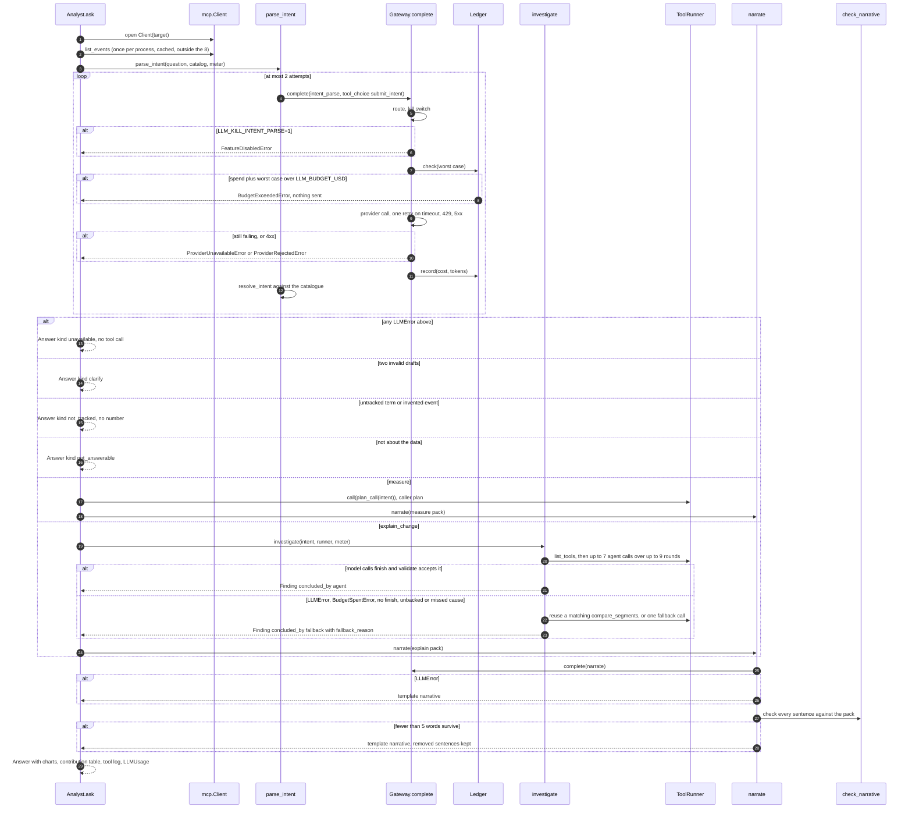

# Low Level Design: Klaritics AI Analyst service

- Task: KAI-4 (documents the code built under KAI-1 to KAI-3)
- HLD: [docs/design/HLD.md](HLD.md); ADRs: ADR-0001 to ADR-0005 in [docs/adr/](../adr/)
- Author: unattributed (no `.bearing/company.json`), 2026-10-11, status: Draft (as built)
- Serves: REQ-001 to REQ-035; US-01-001 to US-07-001
- Proves: AC-US-01-001-1 to AC-US-07-001-2 through the TC ids in [docs/testing/test-cases.md](../testing/test-cases.md)

## 1. Scope

The one deployable built from this repository: the Python service whose
packages `app/seed`, `app/analytics`, `app/mcp_server`, `app/llm`,
`app/agent`, `app/guardrails`, `app/reports` and `app/api` run in the `api`
and `mcp` containers. Its boundary is the HTTP API, the MCP transports, the
DuckDB file and the files it writes; OpenRouter and the eval harness
(`evals/analyst`) stay outside it.

## 2. Module layout

Line counts are the files as committed at `48da05c`. No file passes 400 lines;
`app/analytics/service.py` (563) is the exception and is listed under
section 10.

| Package | File | Lines | Owns |
| --- | --- | --- | --- |
| `app/seed` | `__main__.py` | 27 | CLI: `python -m app.seed --path --seed --users` |
| | `scenarios.py` | 100 | Dataset shape (20,000 users, 60 days from 2026-08-02, seed 42), mixes, the three planted scenarios, `ground_truth()` |
| | `generator.py` | 221 | `generate_users`, `generate_events`, `seed`: CSV then DuckDB `COPY`, indexes after load, `meta`, `ground_truth.json` |
| `app/analytics` | `catalog.py` | 44 | `EVENTS` (8), `DIMENSIONS` (5), `PURCHASE_FUNNEL` |
| | `store.py` | 93 | Schema, indexes, `meta`, `connect_read_only` |
| | `models.py` | 347 | Strict input models and result models of the five capabilities |
| | `errors.py` | 54 | `AnalyticsError` and five typed subclasses |
| | `contributions.py` | 212 | Rate and mix decomposition, `explained`, `separation_z`, `rank_causes` |
| | `service.py` | 563 | `AnalyticsService`: validation, SQL, one lock per connection |
| `app/mcp_server` | `server.py` | 229 | `build_server`: five tools, `READ_ONLY` annotations, errors as JSON tool errors |
| | `auth.py` | 23 | `BearerTokenMiddleware` |
| | `__main__.py` | 43 | stdio or HTTP; HTTP refuses to start without `MCP_HTTP_TOKEN` |
| `app/llm` | `types.py` | 133 | `LLMRequest`, `LLMResponse`, `ToolSpec`, `ToolCall`, `LLMError` family, `Completer` |
| | `routing.py` | 57 | `ROUTES` (3), `PRICES`, `MAX_OUTPUT_TOKENS = 600`, `check_routes()` at import |
| | `providers.py` | 207 | `OpenRouterProvider`, `ReplayProvider`, `RecordingProvider`, `wire_body`, `request_key` |
| | `ledger.py` | 82 | `Ledger`: JSONL append, `check`, `record` |
| | `gateway.py` | 145 | `Gateway.complete`, `worst_case_cost`, `killed_features`, `build_provider` |
| `app/agent` | `analyst.py` | 255 | `Analyst.ask`, `Answer`, `Meter`, `plan_call`, `contribution_table` |
| | `intent.py` | 295 | `IntentDraft`, `Intent`, `parse_intent`, `resolve_intent` |
| | `periods.py` | 114 | `PeriodSpec`, `Window`, `resolve`, `cohort_window`, `previous` |
| | `investigate.py` | 230 | `run_agent`, `validate`, `fallback`, `investigate` |
| | `tools.py` | 141 | `ToolRunner`, `MAX_TOOL_CALLS = 8`, `compact` |
| | `narrative.py` | 294 | Evidence packs, `narrate`, template narrative, `MAX_WORDS = 120` |
| | `charts.py` | 156 | Vega-Lite specs per answer kind |
| | `__main__.py` | 52 | `make ask` CLI |
| `app/guardrails` | `numbers.py` | 151 | `Evidence`, `check_narrative`, `limit_words` |
| `app/reports` | `store.py` | 75 | `ReportStore`: JSON per report, id pattern, atomic write |
| | `render.py` | 159 | `markdown`, `page` (escaped HTML) |
| | `rerun.py` | 34 | `rerun`: repeat every logged tool call and compare |
| `app/api` | `analyst/router.py` | 98 | `/v1/questions`, `/v1/reports...` |
| | `health/router.py`, `health/schemas.py` | 55, 19 | `/healthz`, `/readyz` |

Shared wiring outside the list: `app/main.py` (lifespan builds one `Analyst`
per process), `app/core/` (settings, logging, request id, errors, tracing).

## 3. Types and schemas

| Type | Defined in | Validated at |
| --- | --- | --- |
| `QuestionIn` (`question` 3 to 500 chars, `save`, extra forbidden) | `app/api/analyst/router.py` | FastAPI request parsing; 422 on failure |
| `Answer` (kind, narrative, intent, cause, charts, contribution table, tool log, `LLMUsage`) | `app/agent/analyst.py` | Response model of `/v1/questions` and `/v1/reports/{id}`; re-validated on read in `ReportStore.get` |
| `CountQuery`, `FunnelQuery`, `RetentionQuery`, `CompareQuery` (`extra="forbid"`) | `app/analytics/models.py` | Tool argument schema in `app/mcp_server/server.py`, then `check_event`, `check_range`, `check_filters` in `AnalyticsService` |
| `Metric` (count, conversion, retention; discriminator `kind`) | `app/analytics/models.py` | Same |
| `IntentDraft` (model output) | `app/agent/intent.py` | `IntentDraft.model_validate` on the forced tool call, then `resolve_intent` against the catalogue |
| `Intent` (resolved, with dates and assumptions) | `app/agent/intent.py` | Built only by `resolve_intent` |
| `LLMRequest`, `LLMResponse` | `app/llm/types.py` | Built in code; provider replies parsed by `parse_completion` |
| `LedgerEntry` | `app/llm/ledger.py` | Written by `Ledger.record` |
| `Settings` | `app/core/config.py` | Once per process, `get_settings()` |

HTTP shapes are the Pydantic models above; there is no committed
`api/openapi.yaml`, and FastAPI serves `/openapi.json` outside production.

Limits fixed in code: 8 tool calls per question (`app/agent/tools.py`),
7 for the agent with 1 reserved for the fallback (`app/agent/investigate.py`),
at most 2 intent calls, at most 9 investigation rounds, output tokens
500 / 400 / 400 by route and never above 600 (`app/llm/routing.py`, checked
at import), USD 8 cumulative spend (`LLM_BUDGET_USD`), 120 narrative words,
funnel steps 2 to 6, retention days 1 to 30, `top_n` 1 to 20.

## 4. Sequence

### Analyst.ask

A tool error is not a branch: `ToolRunner.call` records it (`ok: false`)
and returns it to the model as a tool message.

### Save and re-run

`POST /v1/questions` with `save: true` calls `ReportStore.save` after
`Analyst.ask`: a random 16-hex id, write to `<id>.tmp`, rename. Error branch:
an `OSError` on write is unhandled and becomes the `500 internal` envelope in
`RequestIdMiddleware`. Re-run is drawn in
[klariticsai-c4.md](../architecture/klariticsai-c4.md), section 4.

### Seed

`seed()` deletes any file at the path, writes users and events to CSV in a
temporary directory, `COPY`s them into a fresh DuckDB file, builds indexes,
writes `meta` and then `ground_truth.json`. UNDEFINED error branch: a failure
after `path.unlink` leaves no store or a store without `meta`; `read_meta`
then raises `LookupError` and the API starts unready.

## 5. Data access

Schema (`app/analytics/store.py`): `users(user_id PK, signup_ts, os, country,
device, acquisition_source, signup_app_version)`, `events(event_id, user_id,
event_name, ts, app_version, os, country, device, acquisition_source)`,
`meta(key PK, value)`. Indexes: `events_name_ts (event_name, ts)`,
`events_user (user_id)`. assumption: DuckDB's ART indexes serve selective
point lookups; the analytical queries below run as columnar scans, measured
at 30 to 390 ms over the 872,645-row local store (HLD section 8).

| Query | Shape | Index or scan |
| --- | --- | --- |
| Dimension values (start-up) | `SELECT DISTINCT <dim> FROM events` x 5 | full scan, 872,645 rows |
| `list_events` | `GROUP BY event_name` with `count(*)`, `count(DISTINCT user_id)` | full scan |
| `count_events` | `WHERE event_name = ? AND ts >= ? AND ts < ? [AND dim IN (...)]`, optional `date_trunc` or `GROUP BY dim` | `events_name_ts` prefix; scan otherwise |
| `funnel` | CTE chain: first step per user in range, each later step `min(ts)` within `window_hours` | scan per step |
| `retention` | cohort CTE (`min(ts)` of the start event per user), distinct return days, `VALUES` of N, left join | scan |
| `compare_segments` | the metric's query for both periods overall, then per dimension: 2 + 2 x 5 = 12 queries by default | as the metric |

Every value is a bound parameter; column names come only from `DIMENSIONS`
(`_filter_sql`). No transactions at runtime: the connection is read-only.
The seeder uses one connection, no explicit transaction; it replaces the file.

Concurrency: each process holds one DuckDB connection; `AnalyticsService._rows`
takes a `threading.Lock` and a fresh cursor per query, so queries in one
process run one at a time. Read-only mode lets the 2 gunicorn workers and the
`mcp` container open their files at once. The ledger (`threading.Lock`,
append) and the report store (`threading.Lock`, temp file and rename) are
safe within a process; across the 2 workers the ledger's in-memory total is
not shared (HLD section 8, decisions conflict 2). No jobs or queues exist.

## 6. Errors

| Error | Created in | Wrapped or caught in | Mapped to |
| --- | --- | --- | --- |
| `EventNotTrackedError` `not_tracked` | `AnalyticsService.check_event` | `_call` in `app/mcp_server/server.py` | MCP tool error, JSON text with `code`, `message`, `retryable`, `details` |
| `InvalidDateRangeError`, `InvalidFilterError`, `InvalidArgumentError`, `CohortTooRecentError` | `AnalyticsService` | same | same |
| Tool error in the analyst | MCP result `is_error` | `ToolRunner.call` records `ok: false` | Shown to the model; kept in the tool log |
| `BudgetSpentError` | `ToolRunner.call` | `investigate` | Fallback with reason "the tool budget ran out" |
| `FeatureDisabledError`, `BudgetExceededError`, `ProviderUnavailableError`, `ProviderRejectedError`, `ReplayMissingError` (all `LLMError`) | `Gateway.complete`, `Ledger.check`, providers | `Analyst.ask` (intent), `investigate`, `narrate` | `unavailable` answer, fallback finding, or template narrative; HTTP 200 in all three |
| `IntentError` | `resolve_intent`, `parse_intent` | `Analyst.ask` | `clarify` answer, HTTP 200 |
| `ReportNotFoundError` | `ReportStore._path`, `ReportStore.get` | `_load` in the router | `NotFoundError`, 404 `not_found` envelope |
| `ServiceUnavailableError` | `get_analyst` when the store is not loaded | `register_exception_handlers` | 503 `service_unavailable` |
| `RequestValidationError` | FastAPI | `register_exception_handlers` | 422 `validation_error`, input values excluded |
| Anything else | anywhere | `RequestIdMiddleware` via `unhandled_response` | 500 `internal`, traceback logged once |

Envelope: `{"error": {"code", "message", "details", "request_id"}}`
(`app/core/errors.py`).

## 7. Configuration

| Variable | Default | When missing | In `.env.example` |
| --- | --- | --- | --- |
| `ENV` | development | development; `production` hides `/docs` and `/openapi.json` | yes |
| `PORT` | 8080 | default | yes |
| `LOG_LEVEL` | info | default | yes |
| `LOG_FORMAT` | json | default | yes |
| `STORE_PATH` | `data/klaritics.duckdb` | default; a missing file makes the API unready | yes |
| `MCP_HTTP_TOKEN` | none | HTTP transport exits 2; compose refuses to start | yes |
| `MCP_HTTP_PORT` | 8090 | default | yes |
| `LLM_MODE` | live | default | yes |
| `OPENROUTER_API_KEY` | none | live calls raise `ProviderUnavailableError`, answers are `unavailable` | yes |
| `LLM_RECORDINGS_DIR` | `evals/recordings` | default | yes |
| `LLM_LEDGER_PATH` | `data/llm_ledger.jsonl` | default | yes |
| `LLM_BUDGET_USD` | 8 (must be above 0) | default | yes |
| `REPORTS_DIR` | `data/reports` | default | yes |
| `OTEL_EXPORTER_OTLP_ENDPOINT` | empty | tracing off | yes |
| `LLM_KILL_INTENT_PARSE`, `LLM_KILL_INVESTIGATE`, `LLM_KILL_NARRATE` | unset | feature on | named in a comment only |
| `APP_NAME` | KlariticsAI | default | missing |
| `WEB_CONCURRENCY` | 2 (Dockerfile) | gunicorn default | missing |

## 8. Tests

Every test name starts with its TC id; [test-cases.md](../testing/test-cases.md)
maps all of them. The limit rules, each with a pass and a give-up test:

| Rule | Within the limit | At the limit |
| --- | --- | --- |
| 8 tool calls | TC-0220 `tests/agent/test_investigate.py` (backed conclusion accepted) | TC-0223 same file (never more than 8, the last is the fallback's), AC-US-04-002-1 |
| One retry | `test_tc0105_transient_failure_is_retried_once` | `test_tc0105_second_transient_failure_is_raised`, `test_tc0105_rejected_request_is_never_retried` |
| 600 output tokens | `test_tc0107_openrouter_sends_capped_request_and_parses_tool_calls` | `test_tc0100_every_route_uses_haiku_and_caps_output_at_600` |
| USD 8 budget | `test_tc0101_cost_is_priced_from_usage_when_the_provider_omits_it`, `test_tc0102_replayed_calls_do_not_count_against_the_limit` | `test_tc0103_call_over_budget_is_refused_before_sending`, AC-US-03-002-1 |
| Intent repair | TC-0217 (one invalid intent repaired) | TC-0217 (two give up) |
| Number check | TC-0300 (derived numbers supported) | TC-0301, TC-0231 (sentence removed), TC-0233 (template) |

Other groups: seed TC-0001 to TC-0007, capabilities TC-0010 to TC-0055, MCP
TC-0060 to TC-0067 (TC-0066 bearer token), gateway TC-0100 to TC-0109,
agent TC-0200 to TC-0239, reports and API TC-0400 to TC-0414 (TC-0403 HTML
escaping), eval pipeline TC-0500 to TC-0504.

Tests not written: a ledger shared by two processes; concurrent calls
passing `Ledger.check` together; a deadline for a whole question.

## 9. Work breakdown

As built (one commit each, from `git log`):

1. `5589155` scaffold, about 5,100 lines (the Bearing scaffold, generated).
2. `d554805` seed and scenarios, 512 lines.
3. `2b04e50` analytics capabilities and contributions, 1,794 lines.
4. `ff6bdff` MCP server, 472 lines.
5. `f4ada2c` LLM gateway, 941 lines.
6. `8d79731` agent: intent, investigation, narrative, guardrail, 2,462 lines.
7. `773eeae` reports and API, 605 lines.
8. `48da05c` evals, 723 lines.

Items 3, 5 and 6 passed 400 lines; they are history, not a plan to repeat.

Remaining, in order, each leaving `make check` green:

1. Record eval answers with an OpenRouter session (`make eval-record`), commit `evals/recordings/`; data only.
2. Add the CI `eval` job running `make eval`; `.github/workflows/ci.yml`, about 20 lines.
3. Settle decisions conflict 2: `WEB_CONCURRENCY=1` in `Dockerfile`, or a ledger that re-reads under a file lock in `app/llm/ledger.py` with two tests (two ledgers on one file, concurrent check); about 80 lines.
4. Analyst API auth and per-caller limit, after its ADR; `app/api/`, `app/core/config.py`, tests; about 200 lines.

## 10. Assumptions

- assumption: DuckDB uses `events_name_ts` only for selective lookups; analytical queries scan. Confirm with `EXPLAIN` on each query; owner Vijay.
- assumption: `app/analytics/service.py` at 563 lines stays one file because it has one reason to change (the SQL of the five capabilities); split by capability if a sixth is added.
- assumption: no client calls `/v1/questions` concurrently enough for the ledger overshoot to matter (HLD A-01).
- Critic: not run (no agent available in this session).
